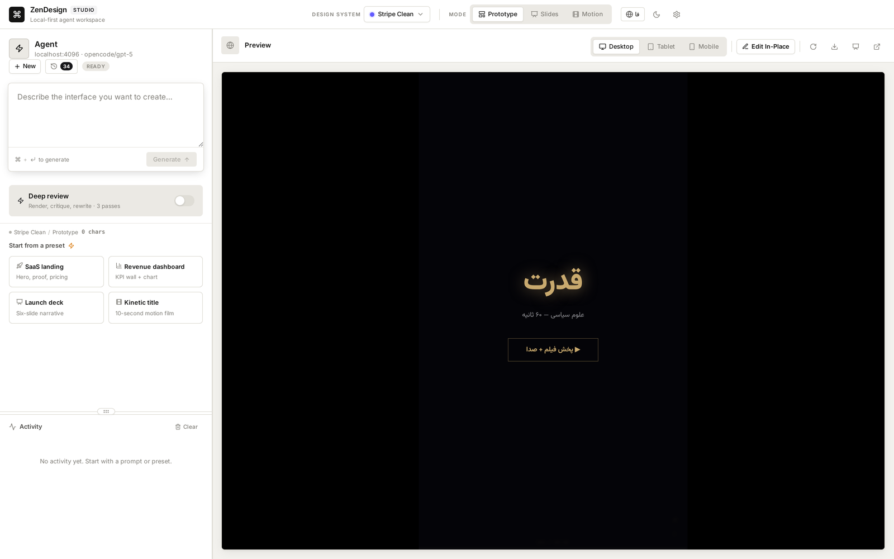
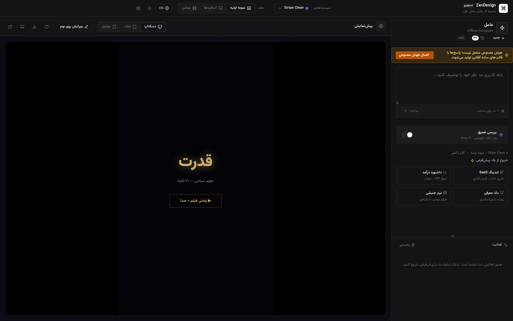
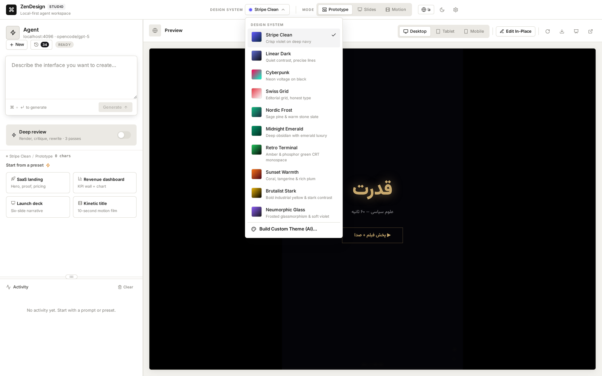
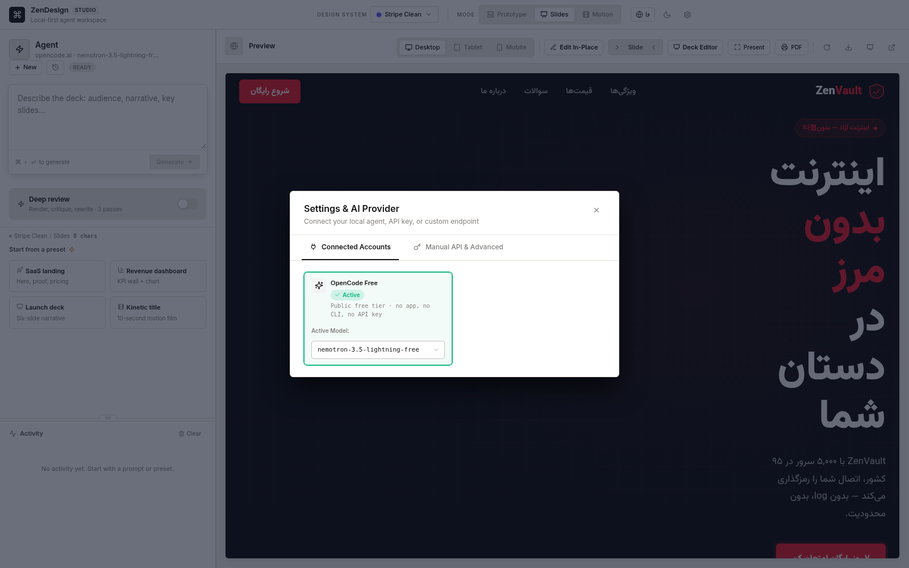
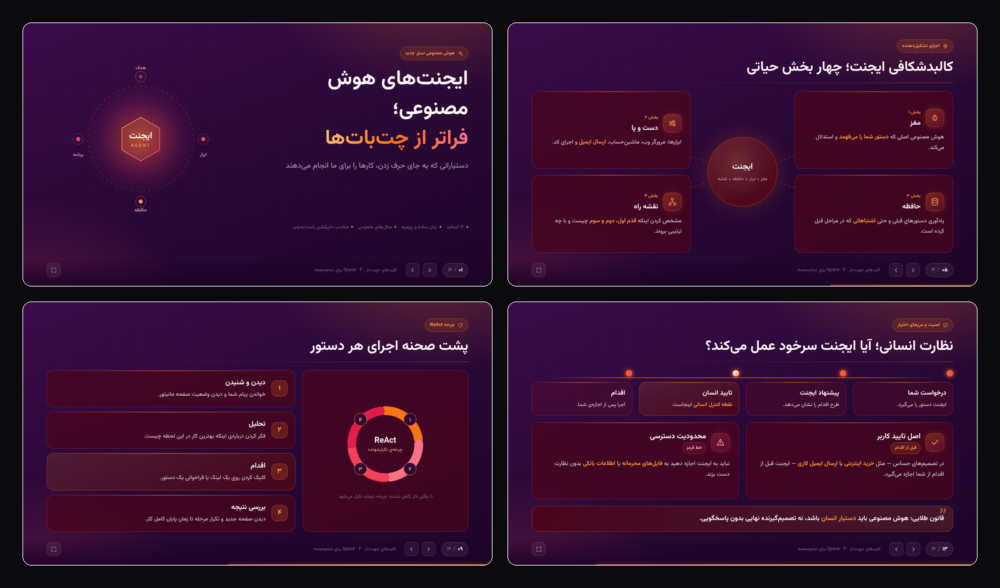
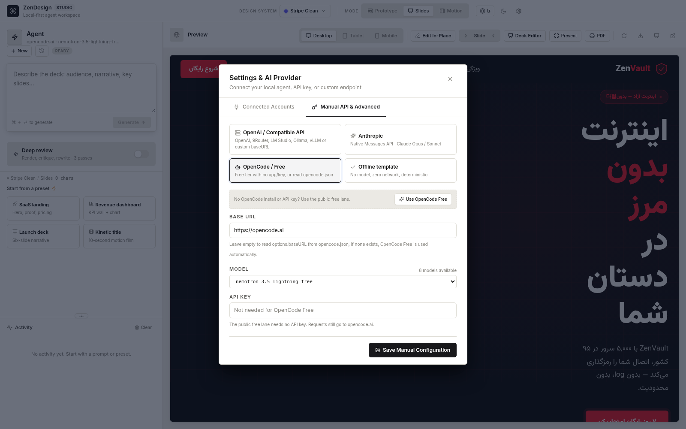
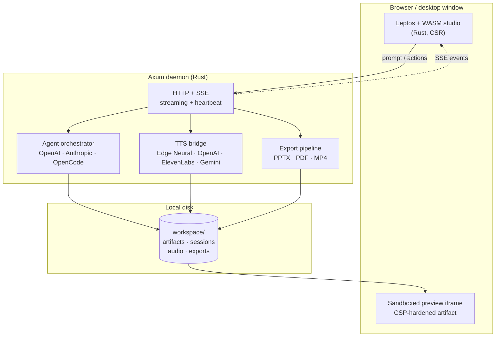

<div align="center">

# ZenDesign

### A local-first AI design studio for the web, for slides, and for motion.

**Prompt → living interface → deck → film. All on your machine.**

[](https://www.rust-lang.org/)
[](https://leptos.dev/)
[](https://github.com/tokio-rs/axum)
[](https://github.com/block-p/zen-design/releases)
[](LICENSE)
[](#quick-start)
[](#contributing)

[English](#why-zendesign) · [فارسی](#فارسی) · [Screenshots](#screenshots) · [Quick start](#quick-start) · [Architecture](#architecture)



<sub>One workspace. Three outputs. A real preview, not a mockup.</sub>

</div>

---

## Why ZenDesign

Most AI design tools are a chat box bolted onto a cloud renderer. ZenDesign is the opposite: a **local-first studio** where the canvas, the agent, the audio, and the exports all live on your computer.

- **One prompt, three native formats.** Generate an interactive prototype, a narrative slide deck, or a beat-synced motion film — not three unrelated tools.
- **Rust all the way down.** The studio is Leptos + WebAssembly; the daemon is Axum. No Node.js runtime, no Electron, no JavaScript bundler.
- **Bring your own model.** OpenAI-compatible endpoints, Anthropic Claude, a local OpenCode agent, or a fully offline deterministic template. Your keys and prompts stay local.
- **Persian is a first-class citizen.** RTL layout, Vazirmatn typography, Persian digits, bilingual EN/FA UI, and narration tuned for Persian speech.
- **Built for the whole loop.** Generate → inspect → edit in place → present → export to `.pptx`, PDF, or MP4.

> **فارسی:** زِن‌دیزاین یک استودیوی طراحی هوش مصنوعیِ لوکال‌فرست است؛ نه یک چت‌باکس متصل به رندر ابری. یک پرامپت می‌دهید و خروجی را به‌صورت پروتوتایپ تعاملی، ارائهٔ اسلاید یا فیلم موشن می‌گیرید. هستهٔ استودیو با Rust و WebAssembly و سرور با Axum نوشته شده است؛ بدون Node.js و بدون Electron.

---

## Screenshots

<table>
  <tr>
    <td width="50%" valign="top">
      
      <br>
      <sub><b>Light studio.</b> Agent panel, live sandboxed preview, design system, and project history in one window.</sub>
    </td>
    <td width="50%" valign="top">
      
      <br>
      <sub><b>Dark + RTL.</b> The Persian interface flips the entire layout. The amber offline banner is contrast-checked for dark mode too.</sub>
    </td>
  </tr>
  <tr>
    <td width="50%" valign="top">
      
      <br>
      <sub><b>Ten design systems.</b> From Stripe Clean to Cyberpunk, plus an AI-assisted custom theme builder.</sub>
    </td>
    <td width="50%" valign="top">
      
      <br>
      <sub><b>Your models, your machine.</b> Local agents, OpenAI-compatible endpoints, or the keyless OpenCode Free lane — one click.</sub>
    </td>
  </tr>
</table>

<p align="center">
  
  <br>
  <sub><b>Slide decks.</b> A four-slide excerpt from a Persian RTL deck — editorial layouts, charts, cards, and speaker notes.</sub>
</p>

---

## Three modes, one canvas

| Mode | What you get | Best for |
| :--- | :--- | :--- |
| **Prototype** | Responsive, component-driven pages with real interactions, device frames (desktop / tablet / mobile), and in-place text editing. | Product landing pages, dashboards, app screens. |
| **Slides** | 16:9 decks with charts, infographics, speaker notes, keyboard navigation, presenter mode, and PDF/PPTX export. | Talks, launch decks, internal reviews, teaching. |
| **Motion** | SVG scenes and kinetic typography arranged on a beat timeline, with procedural sound effects and neural narration. | Title sequences, social films, motion identities. |

Every mode shares the same **10 design systems**, the same agent, the same preview sandbox, and the same local project history.

<details>
<summary><b>Mode details</b></summary>

- **Prototype** — fluid desktop canvas, framed tablet/mobile widths, edit-in-place, HTML export, and a CSP-hardened preview iframe.
- **Slides** — visual deck inspector, full-source editor, add/remove/reorder slides, AI slide actions, presenter timer, notes on `N`, presentation on `F`, exit on `Esc`.
- **Motion** — 16:9 / 9:16 / 4:3 / 1:1 / fill canvases, 10s to 10m durations, Deep Review, procedural Web Audio SFX, and TTS voiceover.

</details>

---

## Design systems

| # | System | Character |
| :-: | :--- | :--- |
| 01 | **Stripe Clean** | Crisp violet on deep navy; polished, technical, calm. |
| 02 | **Linear Dark** | Quiet contrast and precise hairlines for engineering tools. |
| 03 | **Cyberpunk** | Neon voltage, cyan/magenta, deep black. |
| 04 | **Swiss Grid** | Editorial grid, honest type, high contrast. |
| 05 | **Nordic Frost** | Sage pine, warm stone, quiet slate. |
| 06 | **Midnight Emerald** | Obsidian surfaces with emerald and dark gold. |
| 07 | **Retro Terminal** | Amber and phosphor green CRT, monospace. |
| 08 | **Sunset Warmth** | Coral, tangerine, and rich plum. |
| 09 | **Brutalist Stark** | Industrial yellow, hard edges, stark type. |
| 10 | **Neumorphic Glass** | Frosted surfaces, soft violet, gentle depth. |

Need something else? **Build Custom Theme (AI)** turns a short description into a reusable token set — background, surface, text, accent, border, and typography.

---

## AI that stays yours

| Layer | Supported |
| :--- | :--- |
| **OpenAI-compatible** | OpenAI, LM Studio, Ollama, vLLM, 9Router, or any custom base URL. |
| **Native Anthropic** | Claude Messages API (Opus / Sonnet). |
| **OpenCode config** | Reads `opencode.json` and calls its 9Router / Ollama / OpenAI-compatible endpoint directly. **No OpenCode app required.** |
| **OpenCode Free** | 9Router-style public lane with **no app, no CLI, and no API key**. Automatically used when no local config exists. |
| **OpenCode CLI (optional)** | Tool-using local agent, used only when it is installed and no HTTP endpoint is configured. |
| **Offline mode** | Deterministic template fallback — no model, no network. |

- **Auto-detection** scans local agents and endpoints so you can connect in one click.
- **Streaming, not waiting** — the agent streams over SSE with heartbeats, so long generations do not time out.
- **Deep Review** renders frames, critiques the result, and rewrites up to three times for higher-quality output.
- **Background activity** keeps a readable log of every tool call, export, and model event.

### OpenCode without the OpenCode app

9Router does not launch OpenCode to answer a request: it reads the provider endpoint and speaks HTTP. ZenDesign does the same, with two lanes.

**1. Your existing endpoint (config-first)**

1. Read `provider.<name>.options.baseURL` and `options.apiKey` from `opencode.json` (9Router is preferred when present, and the platform config directory is checked on Windows/macOS/Linux).
2. Merge `provider.<name>.models` with the endpoint's live `/v1/models` list.
3. Call `<baseURL>/chat/completions` directly with SSE streaming.

**2. OpenCode Free (no app, no CLI, no key)**

When no local endpoint is configured, the OpenCode tab automatically offers the public free lane that 9Router uses:

- Public model catalog: `GET https://opencode.ai/zen/v1/models`
- Chat endpoint: `POST https://opencode.ai/inference/v1/chat/completions`
- Authorization: `Bearer public`
- The same OpenCode v2 client headers, session id, `read`/`shell` tool fingerprint, and `stream: true` body that 9Router sends
- Free model ids are read live and filtered to those that actually support the protocol; a small fallback list is used only if the catalog is unreachable

Press **Use OpenCode Free** in **Settings → AI provider**. No `opencode` binary, no desktop app, no child process, and no API key ever needs to be stored. If a real `opencode.json` exists, its endpoint still wins; the free lane is the zero-setup default. The public service is third-party and may rate-limit or change availability — prompts are sent to `opencode.ai`, so use your own endpoint for private material.

The CLI remains a last-resort fallback only when no HTTP endpoint exists **and** an `opencode` executable is actually found — including `~/.opencode/bin`, `~/.local/bin`, Homebrew paths, and Windows install locations.

<p align="center">
  
  <br>
  <sub><b>No installation required.</b> The OpenCode tab reads an existing <code>opencode.json</code> over HTTP, or switches to the public free lane with one click.</sub>
</p>

<details>
<summary><b>فارسی: OpenCode بدون نصب اپ</b></summary>

زِن‌دیزاین فایل `opencode.json` را می‌خواند و مستقیم با همان `options.baseURL` و `options.apiKey` صحبت می‌کند — دقیقاً همان کاری که 9Router انجام می‌دهد. مدل‌ها از `provider.<name>.models` و پاسخ زندهٔ `/v1/models` ترکیب می‌شوند. مسیر فایل در ویندوز، مک و لینوکس به‌صورت جداگانه پیدا می‌شود. بنابراین برای استفاده از سرویس 9Router یا Ollama، نیازی به نصب یا اجرای اپ OpenCode نیست.

اگر هیچ endpoint محلی تنظیم نشده باشد، گزینهٔ **OpenCode Free** به‌صورت خودکار پیشنهاد می‌شود؛ همان مسیر عمومی و بدون کلیدی که 9Router استفاده می‌کند:

- فهرست مدل‌ها: `GET https://opencode.ai/zen/v1/models`
- گفتگو: `POST https://opencode.ai/inference/v1/chat/completions`
- هدر `Authorization: Bearer public` به‌همراه همان هدرهای کلاینت OpenCode v2، شناسهٔ نشست، ابزارهای `read` و `shell` و `stream: true`

در **تنظیمات ← ارائه‌دهندهٔ هوش مصنوعی** روی **Use OpenCode Free** بزنید. نه فایل اجرایی OpenCode لازم است، نه اپ دسکتاپ، نه کلید API. اگر `opencode.json` واقعی وجود داشته باشد، endpoint آن در اولویت می‌ماند و مسیر رایگان فقط حالت پیش‌فرض بدون تنظیم است. این سرویس عمومی متعلق به شخص ثالث است و ممکن است محدودیت نرخ یا تغییر دسترسی داشته باشد؛ متن درخواست‌ها به `opencode.ai` فرستاده می‌شود، پس برای محتوای خصوصی از endpoint خودتان استفاده کنید.

CLI فقط زمانی به‌عنوان گزینهٔ آخر استفاده می‌شود که هیچ endpoint HTTP تنظیم نشده باشد و فایل اجرایی هم واقعاً پیدا شود.

</details>

### Voice & sound

- **Edge Neural TTS** — natural Persian voices (Dilara / Farid), plus OpenAI Audio, ElevenLabs Multilingual v2, and Gemini native audio.
- **Pacing math** — word count ≈ seconds × 2.3, so narration and animation land together.
- **Procedural SFX** — synthesized impacts, chimes, and whooshes generated in the browser with Web Audio.

### Export without a subscription

- **`.pptx`** — native PowerPoint with 16:9 layout, dark theme, and RTL Persian text.
- **PDF** — print-ready output with controls stripped, generated through the browser's print pipeline.
- **MP4** — cinematic screen capture of the live preview (Chrome + FFmpeg, Linux/X11 only).

> **Platform note:** MP4 recording and Deep Review's frame capture currently require Linux with X11, Xvfb, `xwininfo`, FFmpeg, and Chrome/Chromium. On macOS and Windows the app works normally and exports PPTX/PDF, but those two capture features return a clear unsupported message instead of recording a black screen.

---

## Quick start

### Prerequisites

- [Rust](https://rustup.rs/) **1.80+**
- `wasm32-unknown-unknown` target and [Trunk](https://trunkrs.dev/)
- Optional: Python 3 with `edge-tts` and `python-pptx` for neural TTS / PPTX
- Optional on Linux: FFmpeg, `Xvfb`, `xwininfo`, and Chrome/Chromium for MP4 recording and Deep Review

```bash
rustup target add wasm32-unknown-unknown
cargo install trunk --locked
```

### Linux & macOS

```bash
git clone git@github.com:block-p/zen-design.git
cd zen-design
./dev.sh
```

Open **http://127.0.0.1:7456**. `dev.sh` rebuilds the WASM studio only when sources change, then starts the daemon.

### Windows

**Prebuilt:** download the latest `zen-design-windows-x86_64.zip`, extract it, and run `zen-design-windows-x86_64.exe` (the server has no console window). Then open **http://127.0.0.1:7456**.

**From source:** build the studio and server as shown below, then double-click **`ZenDesign.vbs`** for a silent, console-free app window. **`ZenDesign-Windows.bat`** does the same but keeps a terminal visible for troubleshooting. Both launchers look for `server/target/release/zen-design-server.exe` or a sibling `zen-design-server.exe`.

### Build from source (all platforms)

```bash
# 1. Studio → WASM
cd studio
trunk build --release

# 2. Server → single self-contained binary
cd ../server
cargo build --release

# Run
./target/release/zen-design-server
```

The release binary embeds the `studio/dist/` assets, so you can ship it as one file. On Windows the binary is `zen-design-server.exe`.

---

## Architecture



- **No JS framework, no bundler.** The UI compiles from Rust to WASM and is served as static assets by the same daemon.
- **Preview isolation.** Generated HTML runs inside an iframe with a strict Content-Security-Policy; it cannot reach the studio or your filesystem.
- **Everything is a file.** Artifacts, sessions, audio, and exports live under `workspace/`; history and settings live in `~/.config/zen-design/`.
- **Self-contained releases.** `rust-embed` bakes the studio into the server binary; the release workflow produces Linux, macOS (Intel/ARM), and Windows builds.

---

## Project layout

```text
zen-design/
├── studio/                  # Leptos 0.8 UI, compiled to WebAssembly
│   ├── src/
│   │   ├── components/      # agent panel, preview, settings, deck drawer…
│   │   ├── data.rs          # modes, design systems, devices, ratios
│   │   ├── i18n.rs          # English / Persian, RTL, digits
│   │   └── stream.rs        # SSE client + activity log
│   ├── style.css            # design tokens, light/dark themes
│   └── dist/                # built WASM + hashed assets
├── server/                  # Axum daemon, agent, TTS, exporters
│   ├── src/
│   │   ├── agent/           # orchestration, providers, deep review
│   │   ├── export/          # PPTX, PDF, MP4 pipelines
│   │   ├── tts.rs           # Edge / OpenAI / ElevenLabs / Gemini
│   │   └── detector.rs      # local model & agent auto-detection
│   └── target/release/      # zen-design-server
├── workspace/               # generated artifact + per-project sessions
├── docs/screenshots/        # README images
├── dev.sh                   # build-if-needed + run (Linux/macOS)
├── launch.sh                # desktop launcher
├── ZenDesign.vbs            # silent Windows launcher
└── ZenDesign-Windows.bat    # Windows console launcher
```

---

## Privacy & safety

- **Local by default.** No telemetry, no account, no mandatory cloud. Network calls go only to the model/TTS endpoints you configure — or to the public OpenCode Free lane when no local provider exists, in which case prompts are sent to `opencode.ai`.
- **Sandboxed output.** Generated artifacts run under a strict CSP; `default-src 'none'`, no frame access, no top navigation.
- **Keys stay in config.** API keys live in your local `config.toml` (or are read from local agent configs) and are never bundled into the studio.
- **Predictable fallback.** With no provider connected, ZenDesign still works using deterministic offline templates and tells you clearly in the UI.

---

## Contributing

Contributions are welcome — especially around RTL typography, accessibility, export fidelity, and new provider adapters.

- Open an issue before a large feature so we can align on the architecture.
- Keep the studio dependency-light: Rust + WASM, no Node runtime.
- Test both **light and dark** themes, and both **English and Persian** layouts.
- For UI changes, include a screenshot or a short clip in the PR.

```bash
# run the checks before opening a PR
cd studio && cargo check --target wasm32-unknown-unknown
cd ../server && cargo check
```

---

## License

MIT © 2026 [block-p](https://github.com/block-p). See [LICENSE](LICENSE).

<div align="center">

**If ZenDesign saves you a design sprint, leave a star — it helps the project grow.**

</div>

---

<div dir="rtl">

## فارسی

### زِن‌دیزاین چیست؟

**زِن‌دیزاین** یک استودیوی طراحی هوش مصنوعیِ لوکال‌فرست است که یک پرامپت را به سه خروجی متفاوت تبدیل می‌کند: **پروتوتایپ تعاملی وب**، **ارائهٔ اسلاید حرفه‌ای** و **فیلم موشن سینمایی**. برخلاف ابزارهای ابری، بوم، عامل هوش مصنوعی، صدا و خروجی‌ها همه روی کامپیوتر خودتان اجرا می‌شوند.

- **یک پرامپت، سه فرمت.** پروتوتایپ، اسلاید و موشن در یک محیط یکپارچه — نه سه ابزار جدا.
- **تماماً Rust.** رابط کاربری با Leptos و WebAssembly، سرور با Axum؛ بدون Node.js و بدون Electron.
- **مدل دلخواه شما.** سازگار با OpenAI، آنتروپیک، عامل محلی OpenCode یا حالت آفلاین قطعی.
- **فارسیِ واقعی.** چیدمان راست‌به‌چپ، فونت وزیرمتن، اعداد فارسی، رابط دوزبانه و گویندگی متناسب با زبان فارسی.
- **چرخهٔ کامل.** تولید → بازبینی → ویرایش روی بوم → ارائه → خروجی `.pptx`، PDF و MP4.

### نگاهی به تصاویر

تصاویر واقعی برنامه در پوشهٔ [`docs/screenshots`](docs/screenshots) قرار دارند: استودیوی روشن، حالت تاریک با رابط فارسی و پیام آفلاین خوانا، ده سیستم طراحی، تنظیمات اتصال مدل‌های محلی، و نمونهٔ اسلایدهای فارسی.

### سه حالت طراحی

| حالت | خروجی | مناسب برای |
| :--- | :--- | :--- |
| **پروتوتایپ** | صفحات وب واکنش‌گرا با تعامل واقعی، فریم دسکتاپ/تبلت/موبایل و ویرایش مستقیم متن | لندینگ محصول، داشبورد، صفحات اپلیکیشن |
| **اسلایدها** | ارائهٔ ۱۶:۹ با نمودار، اینفوگرافیک، یادداشت گوینده، حالت پرزنتر و خروجی PDF/PPTX | سخنرانی، معرفی محصول، آموزش |
| **موشن** | صحنه‌های SVG و تایپوگرافی کینتیک روی تایم‌لاین بیت‌ها، با افکت صوتی و گویندگی | تیتراژ، فیلم شبکه‌های اجتماعی، هویت متحرک |

### سیستم‌های طراحی

ده سیستم آماده: **Stripe Clean**، **Linear Dark**، **Cyberpunk**، **Swiss Grid**، **Nordic Frost**، **Midnight Emerald**، **Retro Terminal**، **Sunset Warmth**، **Brutalist Stark** و **Neumorphic Glass**. با «سازندهٔ تم سفارشی (AI)» می‌توانید پالت و تایپوگرافی اختصاصی خودتان را بسازید.

### هوش مصنوعی، صدا و خروجی

- اتصال به **OpenAI و هر API سازگار** (LM Studio، Ollama، vLLM، 9Router)، **Anthropic Claude**، **پیکربندی OpenCode** و **قالب آفلاین**.
- **OpenCode بدون نیاز به اپ:** خواندن `opencode.json`، ترکیب مدل‌های آن با `/v1/models` و ارسال درخواست مستقیم به همان endpoint (روش 9Router).
- شناسایی خودکار سرویس‌های محلی و وارد کردن تنظیمات OpenCode.
- **بازبینی عمیق (Deep Review):** رندر، نقد و بازنویسی تا سه مرحله. (ضبط فریم فعلاً فقط در لینوکس/X11)
- **تبدیل متن به گفتار:** صداهای طبیعی فارسی Edge (دلارا و فرید)، OpenAI Audio، ElevenLabs و Gemini.
- **خروجی:** پاورپوینت (`.pptx`)، PDF آمادهٔ چاپ و ویدئوی MP4 با ضبط سینمایی. (MP4 فعلاً فقط در لینوکس/X11)

> **نکتهٔ پلتفرم:** ضبط MP4 و گرفتن فریم برای Deep Review در حال حاضر به لینوکس با X11، Xvfb، `xwininfo`، FFmpeg و Chrome/Chromium نیاز دارد. در مک و ویندوز بقیهٔ برنامه عادی کار می‌کند و خروجی PPTX/PDF دارد، اما این دو قابلیت به‌جای ضبط صفحهٔ سیاه، پیام واضح «پشتیبانی نمی‌شود» برمی‌گردانند.

### شروع سریع

```bash
rustup target add wasm32-unknown-unknown
cargo install trunk --locked

git clone git@github.com:block-p/zen-design.git
cd zen-design
./dev.sh
```

سپس به آدرس **http://127.0.0.1:7456** بروید. در ویندوز، نسخهٔ آماده را از Releases دانلود و فایل اجرایی را باز کنید؛ اگر پروژه را از سورس ساخته‌اید، با دوبار کلیک روی **`ZenDesign.vbs`** برنامه در پنجره‌ای مستقل و بدون کنسول باز می‌شود.

### معماری و امنیت

- استودیو با **Leptos + WASM** در مرورگر اجرا می‌شود و سرور **Axum** ارتباط HTTP/SSE را مدیریت می‌کند.
- پیش‌نمایش خروجی در یک **iframe با CSP سخت‌گیرانه** ایزوله شده است.
- پروژه‌ها، نشست‌ها، صداها و خروجی‌ها به‌صورت محلی در پوشهٔ `workspace/` و تاریخچه/تنظیمات در مسیر استاندارد تنظیمات سیستم (`config.toml`) نگهداری می‌شوند.
- هیچ تلمتری یا حساب ابری اجباری وجود ندارد؛ تنها اتصال‌های شبکه، سرویس‌هایی هستند که خودتان تنظیم می‌کنید. اگر هیچ سرویس محلی تنظیم نشده باشد، مسیر عمومی **OpenCode Free** ممکن است به‌کار برود و در آن حالت متن درخواست‌ها به `opencode.ai` فرستاده می‌شود.

### مشارکت و لایسنس

مشارکت در توسعهٔ پروژه — به‌ویژه در زمینهٔ تایپوگرافی راست‌به‌چپ، دسترس‌پذیری، کیفیت خروجی و پشتیبانی از سرویس‌های جدید — پذیرفته است. لطفاً پیش از تغییرات بزرگ یک Issue باز کنید. پروژه تحت لایسنس **MIT** منتشر شده است.

</div>
